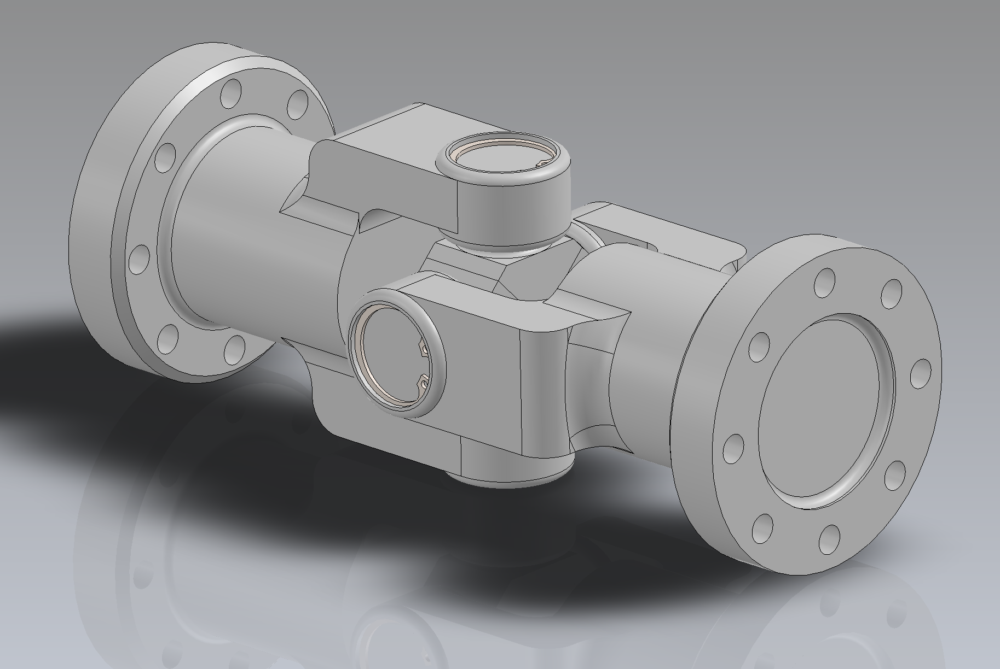

# Universal Joint (Cardan Joint) — CAD Design & Technical Drafting

A universal joint designed and assembled in **SolidWorks**, created as part of the *Design Fundamentals* module at University of Oldenburg.

---

## 📷 Gallery & Visuals

| 3D CAD Assembly | 2D Technical Drawing |
| :---: | :---: |
|  |  |
---

## ⚙️ Key Technical Features

* **Kinematics & Assembly Mates:** Parametric 3D CAD assembly configured with rotational degrees of freedom (DOF) between the yokes, spider (cross-piece), and pins, allowing realistic joint movement and angle transmission.
* **Parametric Part Modeling:** Fully constrained individual components modeled according to technical exercise requirements.
* **2D Technical Drafting:** Comprehensive mechanical drafting including main dimensions, projection views, and section cuts created to illustrate component geometry and assembly layout.

---
